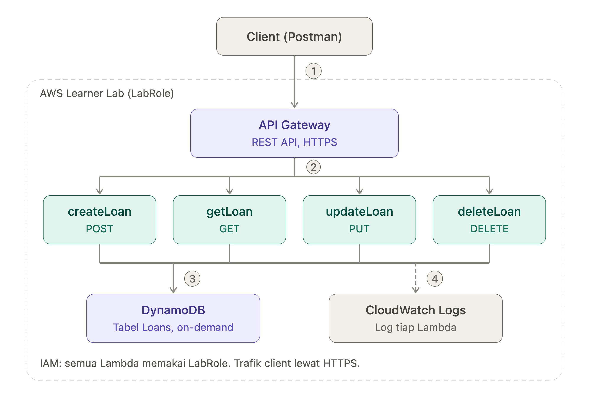

# Design Brief: Lab Equipment Loan

## 1. Use case

Sistem peminjaman alat lab/kampus. Pengguna mencatat peminjaman alat, melihat statusnya, memperbarui status saat alat dikembalikan, dan menghapus catatan yang salah.

Masalah yang diselesaikan: pencatatan peminjaman manual rawan hilang dan sulit dilacak.

## 2. Solusi dan track

Track C (Serverless): API Gateway + Lambda + DynamoDB.

Alasan: biaya mengikuti pemakaian (hemat kredit Learner Lab), tanpa pengelolaan server, dan setiap fungsi dapat dipecah menjadi layanan mandiri.

## 3. Arsitektur



Request dari client masuk ke API Gateway, diteruskan ke Lambda sesuai route, lalu Lambda membaca/menulis tabel DynamoDB `Loans`. Log dikirim ke CloudWatch.

Pemecahan microservices: satu Lambda per operasi sehingga masing-masing dapat di-deploy, diskalakan, dan di-debug terpisah.

Rencana pengembangan: service notifikasi keterlambatan (DynamoDB Streams -> Lambda -> SNS) dan service katalog `Equipment`.

## 4. Entitas data: Loan

| Atribut       | Tipe                   | Keterangan                        |
| ------------- | ---------------------- | --------------------------------- |
| loanId        | String (partition key) | UUID, dibuat otomatis oleh Lambda |
| equipmentName | String                 | Nama alat yang dipinjam           |
| borrowerName  | String                 | Nama peminjam                     |
| borrowDate    | String (ISO 8601)      | Tanggal pinjam                    |
| dueDate       | String (ISO 8601)      | Batas pengembalian                |
| status        | String                 | BORROWED atau RETURNED            |

Aturan bisnis: peminjaman dianggap terlambat jika `dueDate` sudah lewat dan `status` masih `BORROWED`. (Perancangan saja, belum diimplementasikan.)

## 5. Endpoint CRUD

| Operasi | Method dan route   | Fungsi     | Respons sukses | Respons gagal          |
| ------- | ------------------ | ---------- | -------------- | ---------------------- |
| Create  | POST /loans        | createLoan | 201            | 400 (data tidak valid) |
| Read    | GET /loans/{id}    | getLoan    | 200            | 404 (tidak ditemukan)  |
| Update  | PUT /loans/{id}    | updateLoan | 200            | 400, 404               |
| Delete  | DELETE /loans/{id} | deleteLoan | 200            | 404                    |

**Contoh request `POST /loans`**

```json
{
  "equipmentName": "Osiloskop Digital",
  "borrowerName": "Budi Santoso",
  "borrowDate": "2026-11-25",
  "dueDate": "2026-11-28"
}
```

**Contoh respons 201 (berhasil dibuat)**

```json
{
  "loanId": "7b0c2f7e-3a41-4d2e-9a55-1c8e5f0d6a12",
  "equipmentName": "Osiloskop Digital",
  "borrowerName": "Budi Santoso",
  "borrowDate": "2026-11-25",
  "dueDate": "2026-11-28",
  "status": "BORROWED"
}
```

**Contoh request `PUT /loans/{id}` (alat dikembalikan)**

```json
{ "status": "RETURNED" }
```

Respons 200 mengembalikan data `Loan` yang sudah diperbarui.

**Contoh respons 404 (`GET`, `PUT`, atau `DELETE` dengan id tidak ada)**

```json
{ "message": "Loan not found" }
```

## 6. IAM dan keamanan

Semua Lambda memakai LabRole bawaan Learner Lab (pembuatan role baru dibatasi). Rencana produksi: role terpisah dengan izin minimal per fungsi. Akses ke DynamoDB hanya lewat Lambda, trafik melalui HTTPS.
